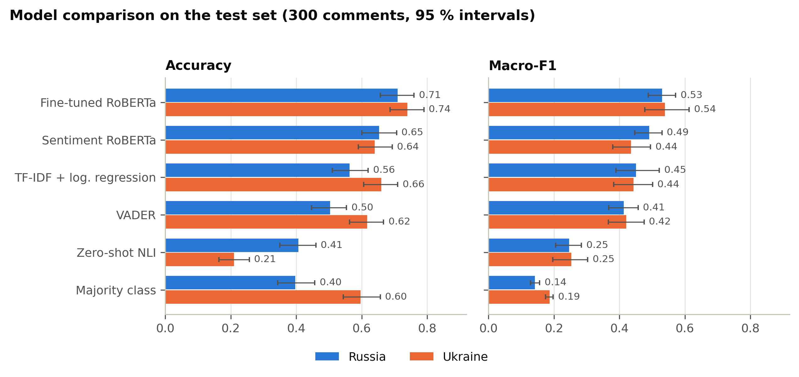
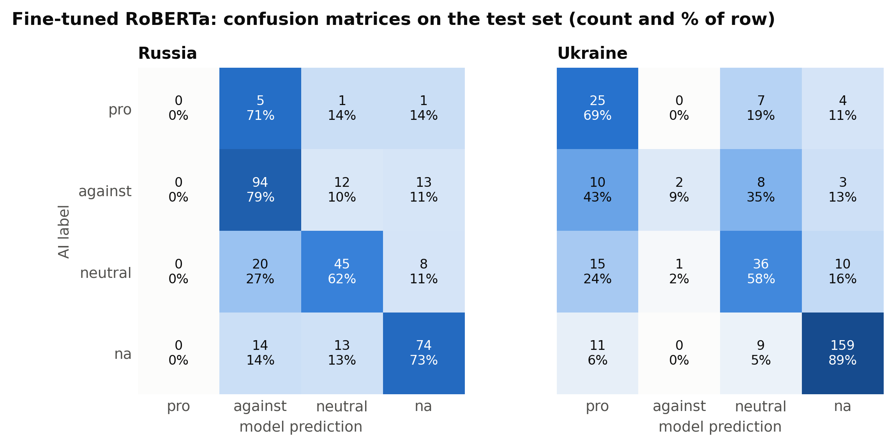
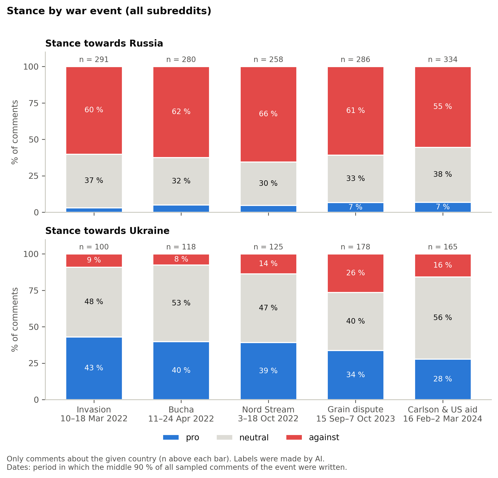

# Text Analytics: Stance towards Russia and Ukraine on Reddit

## Project overview

For each Reddit comment we predict the author's stance towards **Russia** and, separately, towards **Ukraine**
(`pro`, `against`, `neutral`, `na` = the comment is not about the country). We compare six approaches and describe
stance in the periods following five war events: the invasion, Bucha, Nord Stream, the grain dispute and the
Carlson interview / US aid debate.

**All training and test labels were made by an AI annotator.** Every score means agreement with that annotator,
not with a human truth.

## Repository navigation

| What | Where |
|---|---|
| Data collection | `1reddit_scraper.py` |
| Data cleaning | `2data_cleaning.py` |
| Sampling, annotation, split | `scripts/annotation/` |
| Baselines and models | `scripts/models/` |
| Metrics and figures (code) | `scripts/evaluation/` |
| Figures | `figures/` |
| Anonymised data sample | `data/sample/sample_anonymized.csv` |
| Table of metrics | [below](#metrics) |
| Analysed failure cases | [below](#analysed-failure-cases) |

## Data schema and sample

Source: Reddit (r/worldnews, r/europe, r/UkraineRussiaReport, r/politics, r/Conservative), collected through the
Arctic Shift API. Cleaning: 30,462 raw records → 23,932 clean rows. From 8,274 candidate comments (5-150 words,
mentioning Ukraine or Russia) we drew 1,900, proportionally by event and subreddit, and split them by thread into
train (1,300), validation (300) and test (300).

Raw scraped data is not published. The sample holds 50 test comments (10 per event) without author information:

| Column | Meaning |
|---|---|
| `row_id` | row number in the cleaned dataset |
| `event` | event period |
| `subreddit` | source subreddit |
| `text` | cleaned comment text |
| `stance_russia`, `stance_ukraine` | `pro` / `against` / `neutral` / `na` |
| `uncertain` | 1 = the annotator was unsure about at least one country |

## Metrics

Test set, 300 comments. The winner was chosen on validation.

| Approach | Russia accuracy | Russia macro-F1 | Ukraine accuracy | Ukraine macro-F1 |
|---|---|---|---|---|
| **Fine-tuned RoBERTa** | **0.710** | **0.531** | **0.740** | **0.539** |
| Sentiment RoBERTa | 0.653 | 0.491 | 0.640 | 0.436 |
| TF-IDF + logistic regression | 0.563 | 0.451 | 0.660 | 0.443 |
| VADER | 0.503 | 0.413 | 0.617 | 0.421 |
| Zero-shot NLI | 0.407 | 0.246 | 0.210 | 0.253 |
| Majority class | 0.397 | 0.142 | 0.597 | 0.187 |

95 % bootstrap intervals of the winner: Russia accuracy 0.66-0.76, Ukraine accuracy 0.69-0.79. Its advantage over
sentiment RoBERTa on Russia is not clear (macro-F1 difference +0.039 [-0.000, +0.080]).

The high-level score hides weak classes: the winner found **0 of 7** pro-Russia and **2 of 23** anti-Ukraine
test comments.



## Analysed failure cases

### 1. Opposition read as support

| Input | Label | Model |
|---|---|---|
| "Now we can stop giving money to Ukraine" | Ukraine `against` | Ukraine `pro` |

**Why:** the opposition is carried by "stop giving", while the model follows the mentioned country. The training
data holds 68 anti-Ukraine pairs against 154 pro-Ukraine ones. A hand-written test, "I do not support Ukraine.",
is also answered with `pro`.

### 2. Countries swapped

| Input | Label | Model |
|---|---|---|
| "... Pooty and his sycophants ... do not consider that Ukraine has any right to exist." | Russia `against`, Ukraine `na` | Russia `na`, Ukraine `pro` |

**Why:** the nickname is not recognised as Russia, and the word "Ukraine" triggers `pro`.



## Stance by period



Opposition to Ukraine is highest in the grain dispute period (26 %), but within r/worldnews and r/europe only it is
12 % (`figures/3_stance_control.png`), so much of the difference comes from the changing subreddit mix. The dates
show when the comments were actually written, mostly after each event.

## Running the code

```bash
pip install -r requirements.txt
```

The scripts need files that are not published here because they contain comment texts or were made by hand:
the cleaned dataset (`data/raw/reddit_cleaned_full.csv`) and the pilot and annotation files in `data/sample/`.

| Order | Script |
|---|---|
| preparation | `1reddit_scraper.py`, `2data_cleaning.py` |
| 1 | `scripts/annotation/03_sampling.py` |
| 2 | `scripts/annotation/03b_pilot.py` |
| 3 | `scripts/annotation/03c_pilot_agreement.py` |
| 4 | `scripts/annotation/03d_ai_labels.py` |
| 5 | `scripts/annotation/03e_split.py` |
| 6 | `scripts/annotation/03f_compare_ai.py` |
| 7 | `scripts/models/11_baseline_tfidf.py` |
| 8 | `scripts/models/12_sentiment.py` |
| 9 | `scripts/models/13_zeroshot.py` |
| 10 | `scripts/models/14_finetune.py` |
| 11-13 | `scripts/models/14_finetune.py --fraction 0.25`, `0.5`, `0.75` |
| 14 | `scripts/evaluation/15_compare.py` |
| 15 | `scripts/evaluation/16_graphs.py` |

`scripts/config.py` holds paths and settings, `scripts/utils.py` shared functions.

## Limits

- No human check of the test labels. A 50-comment pilot (one person vs. AI, earlier rules) gave Cohen's kappa
  0.56 for Russia and 0.69 for Ukraine.
- Only comments with a country keyword were sampled; five subreddits, English only.
- Comments are judged without their parent comment.
